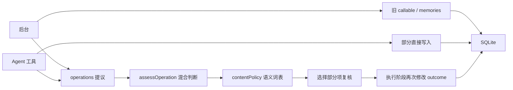
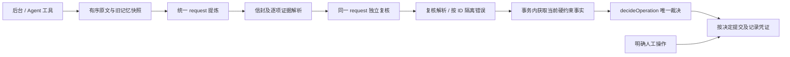

# 记忆写入内核整理与离线验收

本次按已批准的范围替换写入判断链路。整理轮次标记为 kernel-v7；**生产提炼、复核及阶段数据统一使用协议 `version=5`**，没有传输版与内部版之间的双重转换。包版本仍为 0.1.3，未发布、安装、提交或推送。

已完成的结论：生产协议路径从两条收敛到一条，模型传输实现从两处收敛到一处，最终结果由 `decideOperation` 单独给出。统一入口通过当前离线测试、冻结历史测试、源码检查、构建和真实 SDK 本机回环。**这只能证明结构与确定性行为的验收结果，不能证明新提示词下模型的语义准确率提高。**

## 1. 保留、合并、移出生产路径

| 范围 | 处理结果 |
|---|---|
| SQLite、ID、修订、来源、审计、数据目录 | 保留。`user_version` 仍为 3，迁移模块字节不变；不新增表或列，不改写旧数据。 |
| 采集、分片、截断、相邻上下文、凭据遮蔽 | 保留。迁移了当前实现上的长消息、覆盖范围与上下文回归。 |
| 关键词、向量、主体召回、预算、快照失效 | 保留。检索及注入算法未调整；原检索、预算、跨项目和遗忘缓存测试继续针对当前实现运行。 |
| 锚点、引用范围、角色、遮蔽检查 | 合并到 `src/evidence.mjs` 的 `resolveEvidence`。提炼与复核解析都使用它；提交时用相同实现对当前遮蔽状态复查，不另外实现一套引用判断。 |
| 两阶段响应解析 | `src/extraction.mjs` 共用信封校验和逐项错误隔离；各阶段保留自己的字段校验。宿主编号使用原数组位置 `op0…op11`，无效项也保留原编号。 |
| 两阶段传输 | `dsh/extractor.mjs` 只有 `request(phase, payload, signal, meta)`；共用路由、超时、用量和审计。返回原始回答，解析器负责格式。 |
| 后台与 Agent 工具 | 都进入 `processOperations`，都提炼和独立复核。工具请求约束操作、正文、目标、版本和范围；工具参数不冒充用户原文。 |
| 最终结果 | `src/policy.mjs::decideOperation` 是纯函数；事实由调用方提供。提炼器和复核器都不指定数据库状态，执行层不修改最终 outcome。 |
| `src/content-policy.mjs` | 从生产树删除。`instructionOnly`、`positiveCause`、`completedActions`、未决语序、因果词、完成动作词表及指令价值规则没有搬进其他模块。 |
| 旧 `policy.mjs` | 删除混合职责的 `assessOperation`、内部协议验证及重复引文/包含范围判断。确定性约束集中在纯裁决表，自然语言含义交给两阶段结构化判断。 |
| 旧协议、callable extractor | 不再存在于生产接口。旧 `memories`、wire v4 / internal v3 分支及旧 callable 返回值只存在于冻结归档。 |
| 各轮评估工具 | 26 个旧脚本核对字节一致后移入可执行冻结归档，不留下依赖已删除接口的当前入口。没有执行其中的付费采集器。 |
| 人工管理操作 | 保持直接操作入口，不增加模型调用；现有版本、来源、替代确认、遗忘和回退保护继续生效。 |

存储层有一处必要修正：原先候选正文碰到相同有效正文，会被去重成有效条目并合并来源。现限制有效条目只与有效写入合并；候选保留独立状态，不把未确认来源加入有效事实。表结构、旧记忆和有效重复条目的去重行为不变。复现及回归见 `kernel-invariants.test.mjs` 的候选重复测试。

详细旧入口引用清单见 [kernel-legacy-references.json](kernel-legacy-references.json)，含 101 处引用及 26 个归档脚本名称。原源码、测试、文档与构建物共 109 个文件按原字节冻结，另外冻结历史测试需要的 44 个依赖文件。

## 2. 前后调用关系与唯一职责

整理前：



整理后：



图中的人工入口仍使用自己的本地人工操作与凭证路径，不调用自动提炼或复核。两类入口共同使用存储的版本、遗忘和事务保护。后台源检查点与决定凭证在同一事务内提交；工具操作不会将整条用户消息标记为已整理。

边界：解析器不读写数据库；裁决器不调用模型或网络、不读写数据库；提交器不以正文中的中文词语推断事实含义。`factsFor` 提供当前目标、重复条目、冲突、墓碑和遮蔽状态；`commitOperation` 仅按决定操作存储并写凭证。完全重复与近义合并的 `merged` 结果也由裁决器决定，提交后不重新改写 outcome。

## 3. 状态表与失败影响范围

语义字段仅保存在现有阶段和操作凭证 JSON：

- `certainty`: `confirmed / unresolved`，表示结论或选择是否确定。
- `authorization`: `ordinary / explicit / candidate_only / none`，表示对应操作获得何种记忆授权。
- `eventState`: `not_applicable / planned / in_progress / completed / failed / cancelled`，表示事件阶段。

| 条件 | 最终处理 |
|---|---|
| 伪造/跨项目来源、上下文单独支撑、越界引用、遮蔽、范围或墓碑约束失败 | 拒绝，不写入有效记忆；模型批准不能越过这些约束。 |
| 复核缺失、重复 ID、非法 `pending`、未知 ID、非法引用 | 受影响项 `review-required`，不写记忆表，保留错误凭证。未知 ID 只记录错误。 |
| 复核 `reject` 或任一阶段 `authorization=none` | 拒绝；版本竞争等原因不能把拒绝改成候选。 |
| 任一阶段未决、候选限制，或授权/事件阶段不一致 | 保存候选；遗忘要求澄清；不覆盖旧条目。 |
| 目标版本变化或历史元数据不足 | 有效复核下保留候选；遗忘要求澄清。墓碑和无效复核优先，不借此进入记忆表。 |
| 双阶段一致并批准，硬约束满足 | 普通项目新增可生效；全局、替代、合并、遗忘、重新记住还要求直接用户来源及对应明确授权。 |
| 已确定但尚未执行的计划 | 可以有效，事件阶段保持 `planned`；不会因“计划”二字被宿主一概降成候选。 |
| 完全重复的有效事实 | 复用原记录并补充证据，不重复索引。分类或替代目标不一致时保留候选。 |
| 明确重新记住 | 要有事实匹配的墓碑、新来源、双阶段明确授权；建新记录并留凭证，原 forgotten 记录不复活。 |

| 故障 | 隔离与恢复 |
|---|---|
| 单项字段错误或引用错误 | 只冻结该项，其他合法项继续；全部决定和错误凭证提交后推进检查点。 |
| 复核顺序改变 | 由稳定 ID 对应，不使用复核数组下标猜测。 |
| 整份 JSON 坏、协议版本错、超出批次上限、截断 | 整批停为需要检查；已收到的原始回答及用量保留，不猜修、不重发。 |
| 请求发出但未取得可复用结果 | 阶段中断、等待检查；自动重试和重启不再次付费发送。 |
| 已保存回答后本地事务失败 | 所有写入/凭证/检查点回滚，恢复只重放已保存阶段；模型请求次数不增加。 |
| 失去租约 | 过期执行者不能提交；已完整保存的阶段可供下一执行者复用，结果不明的阶段不得重发。 |
| 处理期间发生遗忘 | 批次失效，不继续复核或写回；新调度经过墓碑遮蔽。 |
| 旧版本未完成任务 | 不解释为新协议；来源不另行排队付费处理，不重置检查点。 |

为了隔离错误，一项坏复核可能同时留下“复核解析错误”和“该提议未获有效复核”两条凭证；这是两层定位信息，不是两次模型调用，也不产生候选记忆。

## 4. 可复现的复杂度对照

固定统计边界为全部 `src/**/*.mjs` 和 `dsh/**/*.mjs`，包含辅助模块，不统计测试、冻结旧实现或界面文件。使用同一个 AST 解析器统计 `IfStatement`、三元表达式、逻辑表达式（含 `??`）、非 default switch case、catch 和循环节点；这是明确定义的分支节点指标，不冒充通用认知复杂度评分。

| 文件/指标 | 冻结基线 | 整理后 |
|---|---:|---:|
| 全部生产分支节点 | 995 | **802** |
| `content-policy.mjs` | 36 | 0（移出生产） |
| `policy.mjs` | 197 | 94 |
| `operations.mjs` | 93 | 78 |
| `service.mjs` | 205 | 172 |
| `evidence.mjs` | 22 | 21 |
| `extraction.mjs` | 55 | 55 |
| `store.mjs` | 212 | 213 |
| `dsh/extractor.mjs` | 30 | 24 |
| 其他生产文件合计 | 145 | 145 |
| 生产协议路径 | 2 | 1 |
| `prepareCall` 传输实现位置 | 2 | 1 |
| 最终自动裁决入口 | 混合判断、多次修改结果 | 1 个纯函数 |

总计减少 **193 个节点，约 19.4%**。没有以压缩行数作为验收标准，没有新增运行依赖、数据库、常驻服务、供应商或通用规则引擎。统计同时输出前后 import 图；通过静态检查确认旧入口退出生产、唯一裁决调用位置、执行层不修改 outcome，另人工核查语义规则没有换名搬迁。

## 5. 离线验证与历史证据

新入口为 `npm test`，实际执行 `scripts/verify-kernel.mjs`，依次运行当前测试、冻结历史测试、递归源码检查、构建、结构对照和历史证据核对。当前与历史结果独立报告，不能相加当作新模型准确率。

| 验收层 | 结果与范围 |
|---|---|
| 当前实现 | **116/116，通过，无跳过**。含纯裁决、来源/范围/版本/遗忘硬约束、两阶段逐项隔离、恢复、人工确认与回退、采集覆盖、检索、注入、工具和包契约。 |
| 冻结旧实现 | **180/180，通过，无跳过**。所有原始 177 条静态测试声明（循环展开后 180 项）使用完整冻结依赖执行。 |
| 语义契约 | 使用明确标注的模拟提炼/复核结果；成对语序、未决计划、当前状态与未来选择、无价值指令、限定条件、因果和完成状态只验证状态映射。没有让旧回答补新字段参与评分。 |
| 真实 DSH SDK | 标准两阶段、提炼坏项夹杂、非法复核三种本机合成回环；各 2 次请求，同一路由，两个独立消息上下文，无主聊天历史或工具；验证温度 0、输出上限 2048 和 Qwen 兼容协议 `enable_thinking=false`。 |
| 源码与构建 | 全部通过。构建输出与冻结基线 `dist/client.js` 的 SHA-256 一致。 |
| 外网与日用环境 | 离线入口预加载网络守卫，外部请求尝试 **0**；付费模型调用 **0**。没有读取真实聊天或日用凭据，没有加载日用配置或执行部署。 |
| 历史证据 | **124/124** 已有报告/原始回答/评分证据指纹保持一致。 |

当前测试中的三个层次不能混报：硬约束测试即使模拟批准仍阻止非法状态；协议测试验证失败隔离和恢复；语义契约测试给定明确的阶段判断再核对状态，不测模型理解能力。旧语义词表测试仍可在冻结历史套件运行，但不当成新实现仍能依靠词表识别自然语言的证明。

逐条保留、替换和归档理由见 [kernel-test-map.json](kernel-test-map.json)。当前保留 8 条原 v3 非协议测试原文；旧 core 中 5 条断言改成新的错误隔离/统一复核契约，旧版原断言仍在冻结套件执行。没有删除历史失败回答、评分修正或独立验收数据。本轮新合成契约没有使用独立验收案例来调提示词。

本轮先复现后修复的记录包括：新协议接口尚不存在、候选重复被合入有效事实、缺失审计会话标识、复核拒绝被版本冲突误改为候选、墓碑被候选分支遮挡、等价合并中将日期截止按日初比较而误降候选。早期环境限制下的本机网络失败也保留；之后在允许本机回环的执行环境通过，网络守卫全程保留。

验收机器使用 Node.js 25.9.0 和本机 DSH SDK；`prepareCall` 的最低推理档不被泛称为关闭思考，只有合成 Qwen 兼容端点实际观察到 `enable_thinking=false`。其他模型的真实参数支持、语义表现、延迟和费用本轮没有测试。

构建使用已安装的 esbuild 0.28.2（与项目声明一致），没有安装依赖。本机复现命令：

```powershell
$env:DSH_DEV_MODULES = 'D:/AI/AI agents Project/dsh-mail/node_modules'
npm test
```

如果本项目自身已安装开发依赖，可以直接 `npm test`。需要允许仅本机回环；缺少 SDK 或构建依赖时验收失败，不将其跳过后宣称通过。结构统计使用当前 Node 内置 Acorn，仅为开发验收工具，生产不依赖此内部接口；其他 Node 发行版本下该统计工具尚未单独核验。

## 6. 数据兼容、回退和冻结

- 新语义存在阶段及凭证 JSON，记忆表没有补造旧记录的语义判断。旧记录继续按原有状态与范围读取，历史元数据不足的条目不能自动覆盖。
- 旧协议已完成结果、历史模型原始回答和报告均保留。旧未完成任务不会重置或自动发给新协议；新结果不明请求也不会自动重发。
- 现场没有升级日用库，测试只使用内存或隔离临时库。数据目录仍由原插件路径规则决定，文件名、记忆 ID 和来源 ID 没有迁移。
- 后续若部署，先停止工作器并一致性备份数据库及必要的 SQLite 附属文件、插件源码/安装包和配置。回退应同时恢复部署前的插件与一致性数据库备份；不能仅换回旧代码让它处理新协议的未完成任务，也不要反向删列或清除检查点。
- 开发基线可从 `tests/fixtures/kernel-v6-baseline.json.gz` 按清单恢复到独立目录；`npm test` 会解包到 `.cache/kernel-v7/history`，不覆盖当前项目或日用目录。旧付费采集脚本不属于新验证入口，未来运行仍需另行授权。
- 完整机器结果见 [kernel-verification.json](kernel-verification.json)，逐文件冻结清单见 [kernel-release-manifest.json](kernel-release-manifest.json)。原始本机日志保存在 `.cache/kernel-v7/current.tap`、`historical.tap`、`check.log`、`build.log`。

## 7. 仍未证明的事项

**提炼与复核仍可能同时判断错误。** “普通/明确授权”“否定/引文”“因果/完成”“有无持久价值”是模型语义判断；移除句式硬判定后，不能声称宿主已经确定性理解这些含义。宿主确定性保护的是来源、格式、范围、版本、状态上限、墓碑、租约和事务。

普通新增与 Agent 工具现在也需要独立复核，实际费用和延迟可能增加；本轮没有付费测量，不给出节省比例。批次仍保留 2048 输出上限和 90 秒超时，真实模型在多项复核下的截断率尚未测量。

管理界面源码、样式及构建物与本轮基线一致；本轮没有新增视觉验收，也没有将历史截图当作此次改动的验证。新版错误凭证会通过既有操作记录展示原因。

下一阶段只有在单独确定真实模型测试范围后才进行：使用合成数据，分别衡量新协议的事实精确率、关键事实遗漏、错误覆盖、首次结构成功率、延迟和实际总费用。旧轮成绩不能作为新版达标证据；当前日用模型继续保持原配置。
