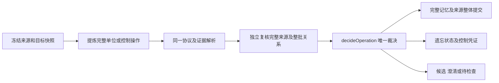

# 记忆写入统一契约修复及离线验收

本轮固定为内部协议 6，数据库结构仍为版本 3。协议、遗忘控制和完整记忆单位共用现有两阶段处理、唯一裁决器和事务提交路径。没有新增语义词表、模型供应商、运行依赖或常驻服务。

离线功能验收通过；生产分支节点从 **802 增至 862，增加 60，约 7.5%**。职责边界更明确，但不能宣称整体代码复杂度已经下降。如果以“相对本轮起点分支总数必须减少”为硬门槛，这一项未达到。

本轮没有付费模型调用、真实聊天处理、日用配置读取或部署，也没有 Git 提交或推送。当前未提交的既有修改保留。

## 1. 修复后的处理契约



### 协议和补证

- `src/extraction.mjs` 的 `CONTRACT` 是字段集合、枚举、版本、正文/批次/理由上限和遗忘空正文约束的共同定义；提示词直接包含同一声明，解析器使用同一对象。`skip` 明确只能包含 `action/evidence`。
- 两阶段共用 `judgment` 解析证据与授权字段；各自保留操作和复核特有校验。提炼编号仍由宿主生成，复核按编号关联，坏项独立隔离。
- 复核可以补充同批冻结来源中的正文依据。最终写入和操作凭证保存两阶段正文依据的并集；明确适用时间也按完整依据核查。
- `authorizationEvidence` 与正文依据分开。高影响操作要求两阶段共同引用的直接、新鲜用户授权，补充正文依据不能单方面扩大权限。辅助上下文可以补全正文，但不能单独授权新操作。
- 复核不能改正文、目标和作用域，也不能以补齐引用替代正文中缺失的限定。

### 控制与遗忘保护

- `unit=control` 与 `action=forget` 对应。保持遗忘和不恢复也走这条路径，只改变保护状态并记录凭证，不保存为持续规则；重复保护不恢复旧条目。
- 新控制指令的精确来源范围保存在现有 `meta` 中，与凭证和遗忘状态同事务提交。重放会遮蔽这些范围；保留原文边界，避免遮蔽前半句后改变后半句锚点。
- 混合消息中可区分的 A/B 范围独立处理；控制与事实共用不可区分范围时，两方都待检查，不先遗忘再丢弃另一事实。
- `MemoryStore.protections` 集中查询精确保护、旧墓碑、控制范围和近义候选。正文包含原事实的新包装也会匹配；不再只依赖提炼是否填写主体/属性。
- 当前项目保护不能通过改写为全局规则绕过；全局保护同样覆盖项目副本。其他项目的保护不进入当前模型输入。
- 近义使用已有 `lexicalScore`，阈值 0.5 仅产生本地候选。命中近义保护、但事实身份不能确定的写入进入 `review-required`，不宣布两者是同一事实、不解除保护。已有原始失败表述在两个模拟阶段都误批为规则时也会挂起。
- 供模型查看的保护候选只有标识、版本、范围、匹配等级和当前消息锚点，不包含已遗忘旧正文。精确锚点与仅相关锚点分开，不能把相关锚点当作唯一目标证据。
- 删除 `authorizedRerecord` 布尔放行。新许可绑定具体保护记录、版本、作用域、项目、新用户来源、正文哈希和操作指纹；提交重新检查，不能同时解除另一事实的保护。人工明确重记也使用限定许可。

### 完整记忆单位

- `unit=self_contained / incomplete / control` 是两阶段的独立结构化判断。任一阶段认为正文缺必要依赖，或两阶段对用途不一致，该项不进入记忆表，连待确认的半条正文也不保存。
- 必要条件跨相邻消息时，提炼必须提出一条完整正文。提交器不拼接摘要、复核不偷偷改写，也不增加第三次修复调用。
- 端口 9460 及“仅本地访问、禁止外部地址访问”的合成案例验证为一条正文；现有注入按整条处理，预算放不下整条排除。
- 原有未决状态、候选授权、项目隔离、版本竞争、租约、检查点和事务约束继续有效。独立事实不会因为同批另一项不完整而被一起丢弃。

## 2. 保留与删除的边界

| 项目 | 结果 |
|---|---|
| SQLite、记忆 ID、来源、修订、凭证和数据目录 | 保留，未升级日用数据库 |
| 关键词/向量排序、RRF、精排、注入五条/1500 预算 | 未调整 |
| DSH 传输、当前模型配置、超时与输出上限 | 未调整；仍每批最多一次提炼和一次复核 |
| 公共工具名称和既有必填参数 | 未调整 |
| UI 源码、样式和构建物 | 指纹与起点一致；本轮不宣称新增视觉验收 |
| 复核引用必须是提炼引用子集 | 删除，替换为冻结来源范围内独立补证 |
| `factsFor` 自行筛选遗忘记录的重复查询规则 | 删除，保护匹配归存储层同一入口 |
| 不限定事实的 `authorizedRerecord` | 删除，替换为具体操作许可 |
| 标点锚点等同于可独立保存的事实 | 不再作为契约；锚点只用于精确定位 |
| 中文未决/因果/完成/遗忘语义词表 | 未增加；关键词评分只用于找保护候选 |

## 3. 先失败再修复的证据

新增测试位于 `tests/kernel-unified.test.mjs`，共 **26 项**，明确标注为宿主契约测试，不是模型准确率。

- `.cache/unified-v6/red.tap`：最初 9 项中 7 项失败。部分失败证明新契约尚不存在，不能全部宣称是旧模型语义失败复现。
- `related-red.tap`：缺少主体元数据时未找到近义保护候选。
- `date-red.tap`：正文已完整，复核补齐明确时间依据后仍被旧检查拒绝。
- `final-boundary-red.tap`：全局控制误受“全局事实分类”限制。
- `two-controls-red.tap`：两个独立控制操作的匹配/遮蔽相互干扰。
- `paraphrase-red.tap`：原失败表述在两个阶段均误批时仍可形成新规则。
- `empty-body-red.tap`：提示词要求遗忘正文为空，解析器未强制同一约束。
- `unified.tap`：26 项最终全部通过，包含对应正向反例、限定恢复许可、来源保护、事务回滚和无新增请求的恢复。

初次基线的三个 SDK 回环在沙箱内报 `Connection error`，日志保留在 `baseline.tap`；允许仅本机回环后，未修改业务代码的隔离基线通过 116/116。这是环境问题，不记作本轮修复收益。隔离基线首次还缺少包/UI 支持文件；补齐经过旧冻结指纹核验的依赖后重新验证，没有删除测试。

## 4. 全量离线验收

| 验收 | 结果 |
|---|---|
| 本轮冻结起点的当前根目录测试 | **116/116** |
| 修复后递归发现的全部测试 | **149/149**，无失败、无跳过 |
| 更早冻结实现及其独立依赖回放 | **180/180** |
| 真实 DSH SDK 本机回环 | 3 种情景均通过，每种恰好两次独立请求；同路由、温度 0、输出上限 2048、合成 Qwen 端点关闭思考、请求/响应/用量审计 |
| 源码检查与构建 | 通过 |
| 网络守卫 | 外网请求尝试 0，付费调用 0 |
| 历史证据 | 原有 124 个证据指纹保持一致；另核对本轮起点的 60 个历史报告、模型评估证据、夹具和 UI 文件 |

149 包含 116 项原当前测试、原来未被根目录入口递归发现的 7 项评估工具测试，以及 26 项新增测试。旧协议原始回答和评分未被改写；测试辅助函数只为合成模拟补充新协议字段，没有为真实旧模型回答补字段。

机器报告见 `unified-v6-verification.json`。正常入口仍是：

```powershell
$env:DSH_DEV_MODULES = 'D:/AI/AI agents Project/dsh-mail/node_modules'
npm test
node --import ./tests/helpers/offline.mjs scripts/measure-unified-memory.mjs
```

本机回环需要执行环境允许 127.0.0.1；外网守卫仍启用。不支持回环时验收失败，不跳过 SDK 后宣称完整通过。

## 5. 复杂度前后对比

统计边界为全部递归 `src/**/*.mjs` 和 `dsh/**/*.mjs`，固定同一 AST 解析器。统计 if、三元表达式、逻辑表达式、非 default switch case、catch 和循环节点；不等同于认知复杂度或性能评分。

| 文件 | 起点 | 修复后 | 增减 |
|---|---:|---:|---:|
| `src/extraction.mjs` | 55 | 55 | 0 |
| `src/evidence.mjs` | 21 | 26 | +5 |
| `src/operations.mjs` | 78 | 75 | -3 |
| `src/policy.mjs` | 94 | 117 | +23 |
| `src/store.mjs` | 213 | 244 | +31 |
| `src/service.mjs` | 172 | 176 | +4 |
| 其他生产文件 | 169 | 169 | 0 |
| **合计** | **802** | **862** | **+60** |

新增主要是完整性/控制状态约束、授权证据交集、限定恢复许可、控制范围及保护候选。编排层减少了重复保护筛选；没有把新增辅助代码排除在统计外。前后 import 图和逐类节点统计在机器报告中。

| 结构指标 | 起点 | 修复后 |
|---|---|---|
| 生产协议 | 1 个，内部版本 5 | 1 个，内部版本 6 |
| 模型传输实现 | 1 | 1 |
| 最终自动裁决入口 | 1 | 1 |
| 每批最多模型阶段 | 2 | 2 |
| 新增生产模块/运行依赖 | — | 0 / 0 |
| 新增数据库或服务 | — | 0 |

结构边界收敛不等于分支数量减少。本轮不以压缩代码、删除测试或把检查搬到统计之外来满足下降指标。

## 6. 合成本地负载测量

每个规模和实现使用独立 Node 进程、内存 SQLite，填充合成遗忘记录；12 次精确保护检查，新增候选扫描执行一次。P95 是这 12 次样本的上分位，不是长期延迟保证。峰值 RSS 包含 Node、SQLite、检查与候选扫描，不能当作插件独占内存。

| 记录数 | 精确保护 P50 修复前/后 | P95 修复前/后 | 新候选扫描一次 | 进程峰值 RSS 修复前/后 |
|---|---|---|---|---|
| 1,000 | 3.84 / 3.33 ms | 6.11 / 6.40 ms | 3.29 ms | 61.1 / 64.8 MiB |
| 10,000 | 32.25 / 35.26 ms | 38.63 / 44.62 ms | 27.01 ms | 147.1 / 213.3 MiB |

原始数据见 `unified-v6-performance.json`。这次 10,000 条负载下，耗时和峰值内存有所增加，不能据此宣称性能优化。候选匹配仍扫描本地保护记录，后续若要优化，应单独验证索引/重复查询处理，保留全部保护边界。

## 7. 仍未解决或未证明的事项

1. **模型仍可能两阶段共同误判。** 完整性字段不会自动理解自然语言；没有被本地匹配命中的近义遗忘仍可能漏过。离线通过不能证明新的提示词使真实模型准确率提高。
2. **近义候选可能多拦。** 0.5 是本地候选阈值，不是语义等价概率；合法新事实与旧遗忘内容文字接近时会挂起核对。当前只用确定性正反例验证，没有给出真实模型下的误拦率。
3. **复杂度和大规模资源指标没有全面改善。** 分支节点增加 7.5%；这次 10,000 条合成保护负载的峰值 RSS 增加。应保留这一结论，不能只展示结构入口数量未增加。
4. **不可分引用与复杂重记仍需澄清。** 同一锚点混合控制和事实、多个保护目标、仅近义而无法确定身份的恢复授权，不自动猜测。不能靠恢复其中一个目标绕过其他保护。
5. **旧数据不自动修正。** 已有拆散记录、旧正文和旧候选没有批量重提炼；旧记录不补造新语义字段。跨批新增限定仍需被正确识别为对完整旧条目的更新。
6. **真实费用、格式率和模型质量未测试。** 新协议增加了授权/完整性字段，仍沿用 2048 输出上限；真实模型多项输出是否更容易截断必须另测。此前模型分数不属于本协议成绩。

## 8. 版本和回退

源码起点存于 `tests/fixtures/unified-v6-baseline.json.gz`，指纹及旧分支统计在 `unified-v6-baseline.json`。新协议只在现有阶段、凭证及 meta 中增加内部信息，未新增数据库表或列。

协议 5 的未完成任务保持待检查，不被协议 6 解释，不重置来源检查点，也不自动重发已付费请求。旧评估脚本及清单保持原样，其冻结核验会拒绝在已变更源码上续跑。

本轮没有日用部署。后续如获授权部署，应先停止工作器并一致性备份 SQLite 及附属文件、插件和配置。回退应恢复匹配的源码与数据备份；旧代码不会执行新增控制范围保护，不能仅降级源码后继续使用包含协议 6 阶段的新数据库。
